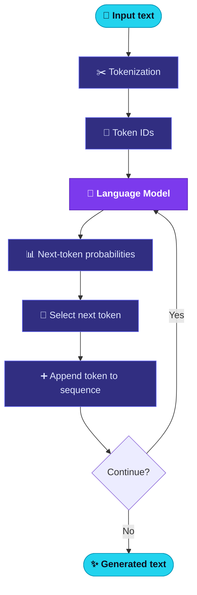
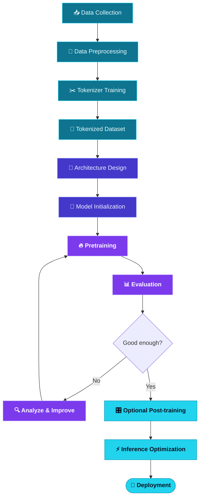
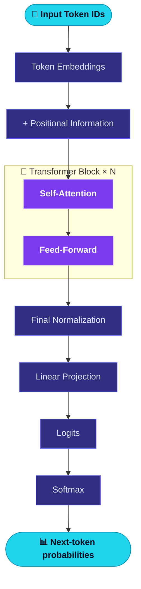
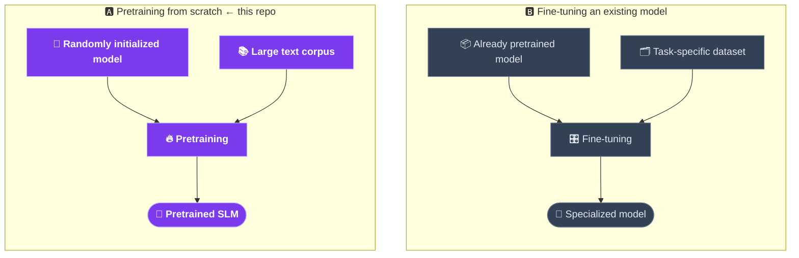
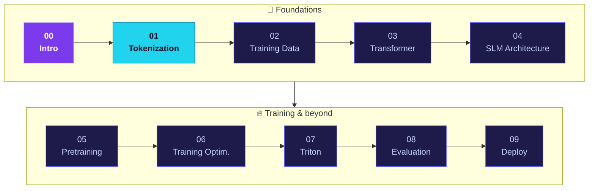
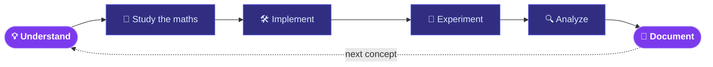

<p align="center">
  
</p>

<p align="center">
  
  
  
  
</p>

<!-- Update the numbers in this badge as lessons are completed -->
<p align="center">
  
  
  
</p>

<p align="center">
  <a href="#-01-what-is-a-small-language-model"><b>🚀 Start here</b></a> &nbsp;·&nbsp;
  <a href="#️-10-the-learning-roadmap"><b>🗺️ Roadmap</b></a> &nbsp;·&nbsp;
  <a href="#-11-test-your-understanding"><b>🧪 Quiz</b></a> &nbsp;·&nbsp;
  <a href="#-12-project-philosophy"><b>🎯 Philosophy</b></a>
</p>

---

> [!IMPORTANT]
> **No pretrained checkpoints. No fine-tuning shortcuts.**
> We start from randomly initialized weights and work our way to a pretrained Small Language Model — understanding every decision and every computation along the way.

This repository is a learning journey and an open-source knowledge base for understanding, implementing, experimenting with and training Small Language Models (SLMs).

We'll work through the maths behind Transformers, study the design choices in modern SLMs, prepare training data, implement every component in **PyTorch**, and then make selected operations faster with **Triton** GPU kernels.

<table>
<tr>
<td width="33%" valign="top">

### 📐 Understand
The maths and intuition behind every layer, from the chain rule of probability to attention.

</td>
<td width="33%" valign="top">

### 🛠️ Build
A decoder-only Transformer written by hand in PyTorch: no black boxes, no `from_pretrained`.

</td>
<td width="33%" valign="top">

### ⚡ Optimize
Profile, then rewrite hot operations as custom Triton kernels.

</td>
</tr>
</table>

> [!TIP]
> Look for the **▶ Try it yourself** blocks. Each one is a short, self-contained snippet you can paste into a notebook and run in seconds. The pure-Python ones need no installs; the rest need only `pip install torch`.

---

## 📚 Table of Contents

| | Foundations | | Building blocks | | The journey |
|:-:|:--|:-:|:--|:-:|:--|
| 🧠 | [01 · What is an SLM?](#-01-what-is-a-small-language-model) | 🏗️ | [06 · Development lifecycle](#️-06-the-complete-slm-development-lifecycle) | 🗺️ | [10 · Learning roadmap](#️-10-the-learning-roadmap) |
| 🔤 | [02 · Language models](#-02-understanding-language-models) | 🧩 | [07 · Inside an SLM](#-07-what-happens-inside-an-slm) | 🧪 | [11 · Knowledge check](#-11-test-your-understanding) |
| 📏 | [03 · What makes a model small?](#-03-what-makes-a-model-small) | ⚖️ | [08 · Pretraining vs fine-tuning](#️-08-pretraining-vs-fine-tuning) | 🎯 | [12 · Project philosophy](#-12-project-philosophy) |
| ⚡ | [04 · Why SLMs?](#-04-why-do-we-need-small-language-models) | 🔬 | [09 · SLMs worth studying](#-09-real-world-small-language-models) | 🚀 | [The end goal](#-the-end-goal) |
| 🔄 | [05 · How text is generated](#-05-how-does-a-language-model-generate-text) | | | | |

---

## 🧠 01. What is a Small Language Model?

Before we get to *small* language models, we need to know what a language model actually does. Try these first: guess, then click to reveal.

<details>
<summary><b>🧩 "The capital of India is ______."</b> &nbsp;<sub>(click to reveal)</sub></summary>

<br/>

**→ New Delhi.** One answer clearly dominates, because the context leaves almost no room for anything else.

</details>

<details>
<summary><b>🧩 "Artificial Intelligence is transforming the way people ______."</b> &nbsp;<sub>(click to reveal)</sub></summary>

<br/>

**→ work · learn · communicate · think · …** Many continuations are plausible. A model doesn't pick a single "right answer"; it holds a **probability distribution** over all of them.

</details>

How does a model make these guesses? It learns patterns from large amounts of text and uses the words that came before to estimate what is likely to come next.

> **Language Model (LM):** a machine-learning model that learns a probability distribution over sequences of tokens.
>
> **Small Language Model (SLM):** a language model with a relatively compact parameter count and compute footprint, compared with larger language models.

SLMs aim to deliver useful language capabilities while cutting down on:

<p>
<kbd>💻 Compute</kbd>&nbsp; <kbd>🧮 Memory</kbd>&nbsp; <kbd>⏱️ Inference latency</kbd>&nbsp; <kbd>💸 Deployment cost</kbd>&nbsp; <kbd>🔋 Energy use</kbd>
</p>

> [!NOTE]
> There is **no official parameter threshold** that defines an SLM. Model size, efficiency, capabilities, training data and deployment needs have to be considered together.

---

## 🔤 02. Understanding Language Models

### The core idea: next-token prediction

Autoregressive language models, including GPT-style models, learn to **predict the next token from the tokens that came before it**.

<p align="center">
  
</p>

The model assigns a probability to every candidate token, picks one according to its **decoding strategy**, appends it to the input, and predicts again. This loop is called **autoregressive generation**.

### The maths behind language modelling

Take a sequence of tokens:

```math
X = (x_1, x_2, \ldots, x_t)
```

A language model estimates the probability of the whole sequence. By the **chain rule of probability**, that splits into one factor per token:

```math
P(X) \;=\; \prod_{i=1}^{t} P\left(x_i \mid x_1, \ldots, x_{i-1}\right)
```

In plain words: *the probability of a sentence is the probability of each token given everything before it, multiplied together.*

```math
P(\text{The sun rises}) \;=\; P(\text{The}) \cdot P(\text{sun} \mid \text{The}) \cdot P(\text{rises} \mid \text{The sun})
```

This is the mathematical foundation of autoregressive language modelling.

<details>
<summary><b>▶ Try it yourself:</b> the chain rule on a tiny corpus (pure Python)</summary>

<br/>

A **bigram** model is the simplest possible language model. It approximates "everything before" with just the previous word, but the chain rule works exactly the same way.

```python
from collections import Counter, defaultdict

corpus = "the sun rises in the east . the sun sets in the west . the moon rises at night ."
tokens = corpus.split()

# Count bigrams: how often does word b follow word a?
pairs = defaultdict(Counter)
for a, b in zip(tokens, tokens[1:]):
    pairs[a][b] += 1

def p_next(prev, word):
    return pairs[prev][word] / sum(pairs[prev].values())

def p_sentence(sentence):
    words = sentence.split()
    prob = 1.0
    for prev, word in zip(words, words[1:]):
        prob *= p_next(prev, word)  # chain rule: one factor per token
    return prob

print("after 'the':", dict(pairs["the"]))
print(f"P(sun rises in the east | starts with 'the') = {p_sentence('the sun rises in the east'):.4f}")
```

```text
after 'the': {'sun': 2, 'east': 1, 'west': 1, 'moon': 1}
P(sun rises in the east | starts with 'the') = 0.0200
```

A neural language model replaces those counts with a network that can look at the **whole** preceding context, not just one word.

</details>

<details>
<summary><b>💡 Why does this matter?</b></summary>

<br/>

Instead of hand-writing grammar rules, sentence structures and vocabulary usage, we train the model to **learn those patterns from data**.

During training, the model adjusts its parameters so it gives higher probability to the tokens that actually come next. Over time, it builds internal representations that capture grammar, context and other statistical regularities in its training data.

</details>

---

## 📏 03. What Makes a Model Small?

One of the most important properties of a language model is its **parameter count**. A parameter is a learnable number inside a neural network. Take a simple linear layer:

```math
y = Wx + b
```

$`W`$ is a weight matrix and $`b`$ is a bias vector. Both are made of learnable parameters that training updates to improve predictions. A model with 100 million parameters has roughly 100 million of these learnable numbers.

### Model size at a glance

*These are illustrative learning categories, not official industry classes.*

| Category | Approx. parameters | Scale |
|:--|--:|:--|
| 🐣 Tiny models | 1M – 10M | `▏` |
| 🐤 Small models | 10M – 500M | `▍▍` |
| 🦅 Compact foundation models | 500M – 3B | `▋▋▋▋` |
| 🐉 Larger language models | 7B+ | `██████████` |

<details>
<summary><b>▶ Try it yourself:</b> count the parameters of your own GPT (PyTorch)</summary>

<br/>

For a GPT-style block, attention adds about $`4d^2`$ parameters and the feed-forward network about $`8d^2`$, where $`d`$ is the hidden size. So each block is roughly $`12d^2`$. Let's check that formula against a real PyTorch model:

```python
import torch.nn as nn

def gpt_params(vocab, d_model, n_layers, context):
    per_block = 12 * d_model**2 + 13 * d_model        # attention (4d²) + MLP (8d²) + biases & norms
    embeddings = vocab * d_model + context * d_model  # token + learned position embeddings (output head tied)
    return n_layers * per_block + embeddings + 2 * d_model  # + final LayerNorm

cfg = dict(vocab=32_000, d_model=512, n_layers=8, context=1024)

# Build the same shape in PyTorch and count for real
d = cfg["d_model"]
model = nn.ModuleDict({
    "tok": nn.Embedding(cfg["vocab"], d),
    "pos": nn.Embedding(cfg["context"], d),
    "blocks": nn.ModuleList(
        nn.TransformerEncoderLayer(d, nhead=8, dim_feedforward=4 * d, batch_first=True, norm_first=True)
        for _ in range(cfg["n_layers"])
    ),
    "ln_f": nn.LayerNorm(d),
})

print(f"formula : {gpt_params(**cfg):,}")
print(f"pytorch : {sum(p.numel() for p in model.parameters()):,}")
```

```text
formula : 42,128,384
pytorch : 42,128,384
```

That's ~42M parameters, firmly in **small model** territory. Notice that ~40% of it is just the embedding table. At small scales, vocabulary size matters a lot.

</details>

<details>
<summary><b>🔍 Why do parameters matter?</b></summary>

<br/>

Parameter count affects:

1. How much storage the model needs.
2. How much memory it takes to load.
3. How much compute it needs.
4. Training and inference cost.
5. Its potential capacity to represent patterns.

But **more parameters don't automatically mean a better model.** Architecture, training data, number of training tokens, optimization and evaluation all matter.

</details>

### Size isn't the only measure of quality

Two models of different sizes can perform very differently depending on dataset quality, number of training tokens, architecture, training duration, optimization strategy and domain specialization.

> [!TIP]
> A well-trained small model can **outperform a much larger one** on a narrow, specialized task.

---

## ⚡ 04. Why Do We Need Small Language Models?

If large language models can handle more complex tasks, why build small ones? Because **not every application needs a huge general-purpose model.**

Picture an AI system that sorts customer-support tickets into five categories. A compact, specialized model may be all you need.

| | Factor | Potential SLM advantage |
|:-:|:--|:--|
| 🧮 | Memory | Lower memory requirements |
| 💻 | Inference | Lower compute requirements |
| ⏱️ | Latency | Potentially faster responses |
| 💸 | Cost | Lower serving costs |
| 📱 | Deployment | More options for running locally |
| 🔒 | Privacy | Can support on-device processing |
| 🎯 | Specialization | Can be optimized for a specific domain |

*These are potential advantages, not guarantees. Real performance depends on architecture, hardware, implementation and workload.*

### SLM vs LLM

| Dimension | 🐤 SLM | 🐉 LLM |
|:--|:--|:--|
| Model size | Generally smaller | Generally larger |
| Compute requirements | Generally lower | Generally higher |
| Deployment | Local and edge-friendly options | Often server-based |
| General capabilities | Often more limited | Often broader |
| Specialization | Can be highly specialized | Can also be specialized |
| Inference cost | Often lower | Often higher |

> [!IMPORTANT]
> The goal isn't the smallest possible model. It's a model that **delivers useful capabilities within a practical compute budget.**

---

## 🔄 05. How Does a Language Model Generate Text?

Watch the sentence grow, one token at a time:

| Step | Context the model sees | Predicted token |
|:-:|:--|:--|
| 1 | <kbd>The</kbd> <kbd>sun</kbd> <kbd>rises</kbd> <kbd>in</kbd> <kbd>the</kbd> | **`morning`** |
| 2 | <kbd>The</kbd> <kbd>sun</kbd> <kbd>rises</kbd> <kbd>in</kbd> <kbd>the</kbd> <kbd>morning</kbd> | **`and`** |
| 3 | <kbd>The</kbd> <kbd>sun</kbd> <kbd>rises</kbd> <kbd>in</kbd> <kbd>the</kbd> <kbd>morning</kbd> <kbd>and</kbd> | **`…`** |



The key idea: the model does **not** write a whole paragraph in one go. It generates **one token at a time**, each time looking at all the context it has so far.

<details>
<summary><b>▶ Try it yourself:</b> softmax, temperature and sampling (pure Python)</summary>

<br/>

The model actually outputs raw scores called **logits**. Softmax turns them into probabilities, and **temperature** controls how bold or cautious the choice is:

```python
import math, random

# Raw scores (logits) for the next token after "The sun rises in the"
logits = {"morning": 3.18, "east": 1.39, "sky": 0.98, "evening": 0.51, "other": 0.0}

def softmax(scores, temperature=1.0):
    exps = {t: math.exp(s / temperature) for t, s in scores.items()}
    total = sum(exps.values())
    return {t: e / total for t, e in exps.items()}

for T in (0.5, 1.0, 2.0):
    probs = softmax(logits, T)
    print(f"T={T}: " + "  ".join(f"{t}={p:.0%}" for t, p in probs.items()))

random.seed(0)
probs = softmax(logits)
print("5 samples at T=1:", random.choices(list(probs), weights=list(probs.values()), k=5))
```

```text
T=0.5: morning=96%  east=3%  sky=1%  evening=0%  other=0%
T=1.0: morning=72%  east=12%  sky=8%  evening=5%  other=3%
T=2.0: morning=45%  east=19%  sky=15%  evening=12%  other=9%
5 samples at T=1: ['sky', 'east', 'morning', 'morning', 'morning']
```

Low temperature → safe and repetitive. High temperature → varied, and eventually chaotic.

</details>

### What is a tokenizer?

A tokenizer turns text into a sequence of whole-number **token IDs**:

```math
\text{Text} \;\rightarrow\; \text{Tokens} \;\rightarrow\; \text{Token IDs}
```

| Stage | Value |
|:--|:--|
| Input | `"Training a language model"` |
| Tokens | <kbd>Training</kbd> <kbd>␣a</kbd> <kbd>␣language</kbd> <kbd>␣model</kbd> |
| Token IDs | `[4521, 264, 982, 1642]` &nbsp;<sub>*(illustrative)*</sub> |

<details>
<summary><b>▶ Try it yourself:</b> the world's smallest tokenizer (pure Python)</summary>

<br/>

```python
text = "Training a language model"

vocab = sorted(set(text))                      # character-level vocabulary
stoi = {ch: i for i, ch in enumerate(vocab)}   # string → id
itos = {i: ch for ch, i in stoi.items()}       # id → string

encode = lambda s: [stoi[c] for c in s]
decode = lambda ids: "".join(itos[i] for i in ids)

ids = encode("a model")
print(f"vocab size: {len(vocab)}")
print(f"encode('a model') -> {ids}")
print(f"decode(...)       -> {decode(ids)!r}")
```

```text
vocab size: 13
encode('a model') -> [2, 0, 8, 10, 3, 4, 7]
decode(...)       -> 'a model'
```

Characters keep the vocabulary tiny but make sequences long. **Byte Pair Encoding (BPE)** finds a middle ground. We'll build one in Module 01.

</details>

---

## 🏗️ 06. The Complete SLM Development Lifecycle

Training an SLM involves far more than defining a Transformer and calling an optimizer. These are the connected stages:



<sub>🟦 Data &nbsp;·&nbsp; 🟪 Architecture &nbsp;·&nbsp; 💜 Training loop &nbsp;·&nbsp; 🩵 Shipping</sub>

Click any stage to expand it:

<details>
<summary><b>📥 Stage 1 — Data Collection</b></summary>

<br/>

Collect text from suitable sources: public-domain books, Wikipedia, educational content, technical documentation, and openly licensed web datasets. The goal is a training corpus that fits what we want the model to learn.

</details>

<details>
<summary><b>🧹 Stage 2 — Data Preprocessing</b></summary>

<br/>

Raw text isn't ready for training. It can contain duplicate documents, spam, bad formatting, leftover HTML, unwanted content and encoding errors. We clean, filter and organize it.

</details>

<details>
<summary><b>✂️ Stage 3 — Tokenization</b></summary>

<br/>

Train or choose a tokenizer that converts the cleaned text into token IDs. Key decisions: the algorithm, vocabulary size, special tokens, byte-level handling, and multilingual support.

</details>

<details>
<summary><b>📐 Stage 4 — Architecture Design</b></summary>

<br/>

Choose the model architecture and its settings. Our first model is a **decoder-only Transformer**. We'll decide the number of layers, hidden size, number of attention heads, context length, vocabulary size, normalization, and how position is encoded.

</details>

<details>
<summary><b>🎲 Stage 5 — Model Initialization</b></summary>

<br/>

Build the architecture and initialize its parameters. There are **no pretrained weights** here. Every parameter starts from a carefully chosen random initialization.

</details>

<details>
<summary><b>🔥 Stage 6 — Pretraining</b></summary>

<br/>

Train the model on next-token prediction: feed in token sequences, predict the next tokens, compute a loss, and update the parameters. Repeat billions of times.

</details>

<details>
<summary><b>📊 Stage 7 — Evaluation</b></summary>

<br/>

Measure how well the model has learned: training loss, validation loss, perplexity, generation quality and benchmark performance.

</details>

<details>
<summary><b>🎛️ Stage 8 — Optional Post-training</b></summary>

<br/>

Adapt the pretrained model to follow instructions or hold conversations, using Supervised Fine-Tuning (SFT), preference optimization, and alignment methods.

</details>

<details>
<summary><b>🚀 Stage 9 — Inference & Deployment</b></summary>

<br/>

Make the trained model usable: decoding strategies, KV caching, quantization, saving and exporting the model, and serving it.

</details>

---

## 🧩 07. What Happens Inside an SLM?

Our first model is a **decoder-only Transformer**. Here's the high-level path a token takes through it:



### The components

<details>
<summary><b>1️⃣ Token Embeddings</b> — IDs become vectors</summary>

<br/>

Each token ID is turned into a dense vector of numbers. With an embedding dimension of 512, every token is represented by 512 numbers.

</details>

<details>
<summary><b>2️⃣ Positional Information</b> — so order matters</summary>

<br/>

Attention by itself doesn't know which token came first, so position has to be added. Common approaches are **learned positional embeddings**, **sinusoidal encodings**, and **Rotary Position Embeddings (RoPE)**.

</details>

<details open>
<summary><b>3️⃣ Self-Attention</b> — tokens look at each other</summary>

<br/>

Self-attention lets each token position pull in information from other relevant positions. Here's the scaled dot-product attention equation:

```math
\operatorname{Attention}(Q, K, V) = \operatorname{softmax}\!\left(\frac{QK^{\top}}{\sqrt{d_k}}\right) V
```

| Symbol | Meaning |
|:-:|:--|
| $`Q`$ | **Queries**: what each token is looking for |
| $`K`$ | **Keys**: what each token offers |
| $`V`$ | **Values**: the information actually passed along |
| $`d_k`$ | Key dimension (used to keep the scores in a stable range) |

We'll derive this equation and implement it ourselves.

</details>

<details>
<summary><b>▶ Try it yourself:</b> causal self-attention in 10 lines (PyTorch)</summary>

<br/>

```python
import math
import torch
import torch.nn.functional as F

torch.manual_seed(0)
B, T, d_k = 1, 5, 16                                  # batch, sequence length, key dimension
Q, K, V = (torch.randn(B, T, d_k) for _ in range(3))

scores = Q @ K.transpose(-2, -1) / math.sqrt(d_k)     # (B, T, T): how much each token attends to each other token
future = torch.triu(torch.ones(T, T, dtype=torch.bool), diagonal=1)
scores = scores.masked_fill(future, float("-inf"))    # causal mask: no peeking at future tokens
weights = scores.softmax(dim=-1)
out = weights @ V

reference = F.scaled_dot_product_attention(Q, K, V, is_causal=True)
print(weights[0].round(decimals=2))
print("matches PyTorch:", torch.allclose(out, reference, atol=1e-6))
```

The printed weight matrix is **lower-triangular**: token 3 can attend to tokens 1–3, never to token 4 or 5. Every row sums to 1, and the last line confirms our version matches PyTorch's built-in `scaled_dot_product_attention`.

</details>

<details>
<summary><b>4️⃣ Feed-Forward Network</b> — per-token processing</summary>

<br/>

Transforms the representation at each token position with learned non-linear operations. This is where much of the model's parameter count lives.

</details>

<details>
<summary><b>5️⃣ Residual Connections & Normalization</b> — keeping deep networks trainable</summary>

<br/>

They make optimization easier and keep training stable in deep Transformer networks.

</details>

<details>
<summary><b>6️⃣ Output Projection</b> — back to the vocabulary</summary>

<br/>

Produces one score (logit) per vocabulary token. With a 32,000-token vocabulary:

```math
\text{Logits} \in \mathbb{R}^{32000}
```

Softmax then turns these scores into a probability distribution.

</details>

> [!NOTE]
> **We won't treat the Transformer as a black box.** For every component, we'll ask: *What does it do? Why does it exist? What's the maths? How does it change the tensor shapes? How does it affect training? How can it be optimized?* Then we'll implement it in PyTorch and rewrite selected operations in Triton.

---

## ⚖️ 08. Pretraining vs Fine-tuning

This is one of the most important distinctions in this repository. **We're primarily interested in pretraining from scratch.**



| Aspect | 🅰️ Pretraining | 🅱️ Fine-tuning |
|:--|:--|:--|
| Starting point | Random initialization | Pretrained weights |
| Dataset | Large-scale corpus | Usually task- or domain-specific |
| Objective | Learn general language patterns | Adapt existing capabilities |
| Training cost | Generally higher | Generally lower |
| Main purpose | Create a pretrained model | Specialize a model |

> [!IMPORTANT]
> **Our primary objective:** build a language model from randomly initialized weights, not just fine-tune an existing one.

---

## 🔬 09. Real-world Small Language Models

Studying existing models helps us make better architecture decisions. These families are worth a close look:

| Model family | Organization | Why study it? | Start here |
|:--|:--|:--|:--|
| **Phi** | Microsoft | Compact model design and training data | [🤗 microsoft](https://huggingface.co/microsoft) |
| **Gemma** | Google | Efficient architecture and model scaling | [ai.google.dev/gemma](https://ai.google.dev/gemma) |
| **Qwen** | Alibaba | Architecture, model configurations, multilingual capabilities | [qwen.ai](https://qwen.ai/) |
| **SmolLM** | Hugging Face | Small-scale language-model development | [🤗 HuggingFaceTB](https://huggingface.co/HuggingFaceTB) |

> [!NOTE]
> We use these models as **architecture and research references**, not as pretrained starting points for our main from-scratch experiments.

---

## 🗺️ 10. The Learning Roadmap

Each topic gets its own Jupyter notebook covering theory, maths, visual explanations, implementation and experiments.



<sub>💜 Complete &nbsp;·&nbsp; 🩵 In progress &nbsp;·&nbsp; 🟪 Up next</sub>

<details open>
<summary><b>✅ 00 — Introduction to SLMs</b> &nbsp;<code>8 / 8</code> &nbsp;·&nbsp; <a href="00_introduction/">notebooks</a></summary>

- [x] [What is an SLM?](00_introduction/00_what_is_an_slm.ipynb)
- [x] [Anatomy of an SLM](00_introduction/01_anatomy_of_an_slm.ipynb)
- [x] [Tokenization: BPE from scratch](00_introduction/02_tokenization.ipynb)
- [x] [Training data for SLMs](00_introduction/03_training_data_for_slms.ipynb)
- [x] [From text to training sequences](00_introduction/04_from_text_to_training_sequences.ipynb)
- [x] [Next-token prediction & the LM objective](00_introduction/05_next_token_prediction_and_language_modeling_objective.ipynb)
- [x] [A tiny language model with PyTorch](00_introduction/06_building_a_tiny_language_model_with_pytorch.ipynb)
- [x] [The SLM training lifecycle, end to end](00_introduction/07_the_slm_training_lifecycle_end_to_end.ipynb)

</details>

<details>
<summary><b>✂️ 01 — Tokenization</b> &nbsp;<code>0 / 4</code></summary>

- [ ] Tokenizer fundamentals
- [ ] Byte Pair Encoding
- [ ] Train your own tokenizer
- [ ] Vocabulary experiments

</details>

<details>
<summary><b>📚 02 — Training Data</b> &nbsp;<code>0 / 5</code></summary>

- [ ] Understanding training corpora
- [ ] Data cleaning
- [ ] Deduplication
- [ ] Data filtering
- [ ] Dataset preparation

</details>

<details>
<summary><b>🧱 03 — Transformer Architecture</b> &nbsp;<code>0 / 9</code></summary>

- [ ] Transformer overview
- [ ] Embeddings
- [ ] Positional information
- [ ] Self-attention
- [ ] Multi-head attention
- [ ] Causal attention
- [ ] Feed-forward networks
- [ ] Normalization
- [ ] Build a Transformer

</details>

<details>
<summary><b>📐 04 — SLM Architecture</b> &nbsp;<code>0 / 7</code></summary>

- [ ] Decoder-only models
- [ ] GPT architecture
- [ ] RoPE
- [ ] RMSNorm
- [ ] SwiGLU
- [ ] Grouped-query attention
- [ ] Parameter-count calculations

</details>

<details>
<summary><b>🔥 05 — Pretraining</b> &nbsp;<code>0 / 7</code></summary>

- [ ] Next-token prediction
- [ ] Training objectives
- [ ] Loss functions
- [ ] Optimizers and schedulers
- [ ] Training loop
- [ ] Checkpointing
- [ ] Train your first SLM

</details>

<details>
<summary><b>🏎️ 06 — Training Optimization</b> &nbsp;<code>0 / 6</code></summary>

- [ ] GPU memory
- [ ] Mixed precision
- [ ] Gradient accumulation
- [ ] Gradient checkpointing
- [ ] `torch.compile`
- [ ] Profiling

</details>

<details>
<summary><b>⚡ 07 — Triton</b> &nbsp;<code>0 / 6</code></summary>

- [ ] Triton introduction
- [ ] Vector operations
- [ ] Matrix multiplication
- [ ] Softmax kernel
- [ ] Normalization kernel
- [ ] Attention kernel

</details>

<details>
<summary><b>📊 08 — Evaluation</b> &nbsp;<code>0 / 5</code></summary>

- [ ] Training and validation loss
- [ ] Perplexity
- [ ] Text generation
- [ ] Model evaluation
- [ ] Error analysis

</details>

<details>
<summary><b>🚀 09 — Inference and Deployment</b> &nbsp;<code>0 / 5</code></summary>

- [ ] Decoding strategies
- [ ] KV cache
- [ ] Quantization
- [ ] Model export
- [ ] Deploy your SLM

</details>

---

## 🧪 11. Test Your Understanding

Answer each one in your head **before** you click. 8 questions; no peeking. 👀

<details>
<summary><b>Q1 · What is the main goal of an autoregressive language model?</b></summary>

<br/>

> **Predict the next token from the preceding context.** It learns a conditional probability distribution over possible next tokens.

</details>

<details>
<summary><b>Q2 · What does "a model with 100 million parameters" mean?</b></summary>

<br/>

> **It contains roughly 100 million learnable numbers**: the weights and, where used, the biases.

</details>

<details>
<summary><b>Q3 · What's the difference between pretraining and fine-tuning?</b></summary>

<br/>

> **Pretraining** starts from randomly initialized weights. **Fine-tuning** starts from an already pretrained model and adapts it.

</details>

<details>
<summary><b>Q4 · Why do we need tokenization?</b></summary>

<br/>

> **To turn text into discrete token IDs** that a neural network can process.

</details>

<details>
<summary><b>Q5 · What is self-attention for?</b></summary>

<br/>

> **It lets each token's representation pull in context from other relevant positions** in the sequence.

</details>

<details>
<summary><b>Q6 · Why divide by √dₖ in attention?</b> &nbsp;🌶️</summary>

<br/>

> **To keep the scores in a stable range.** Dot products grow with the vector dimension. Without scaling, softmax becomes almost one-hot, and the gradients become tiny, which makes training slow and unstable.

</details>

<details>
<summary><b>Q7 · Why does a decoder-only model need a causal mask?</b> &nbsp;🌶️</summary>

<br/>

> **So it can't cheat.** During training, the target at each position is the *next* token. If a position could see future tokens, it would just copy the answer instead of learning to predict it.

</details>

<details>
<summary><b>Q8 · What does a perplexity of 20 roughly mean?</b> &nbsp;🌶️🌶️</summary>

<br/>

> **On average, the model is about as uncertain as if it were choosing uniformly among ~20 tokens.** Perplexity is the exponential of the average per-token negative log-likelihood. Lower is better.

</details>

---

## 🎯 12. Project Philosophy

Every major topic follows the same learning cycle:



| ✅ We choose | over | ❌ |
|:--|:-:|:--|
| Understanding | › | Blindly copying code |
| Mathematical intuition | › | Unexplained abstractions |
| PyTorch implementations first | › | Jumping straight to optimized kernels |
| Small experiments | › | Big training runs too early |
| Reproducibility | › | Impressive-looking results |
| Knowing *why* an architecture choice was made | › | Just knowing *that* it was made |

### 🚫 What this repository is *not*

<p>
<kbd>A general ML course</kbd>&nbsp; <kbd>A basic NLP tutorial</kbd>&nbsp; <kbd>Pretrained model downloads</kbd>&nbsp; <kbd>A fine-tuning-only project</kbd>&nbsp; <kbd>Unexplained training scripts</kbd>
</p>

It is specifically focused on **understanding and building Small Language Models.**

---

## 🚀 The End Goal

By the end of this journey, we should be able to:

- [ ] 🧠 Understand modern SLM architectures
- [ ] ✂️ Train our own tokenizer
- [ ] 📚 Prepare a suitable language-model training corpus
- [ ] 🧱 Implement a decoder-only Transformer
- [ ] 🎲 Initialize a model from scratch
- [ ] 🔁 Build a complete pretraining pipeline
- [ ] 🔥 Train and evaluate our own SLM
- [ ] ⚡ Optimize selected GPU operations with Triton
- [ ] 🔬 Understand modern SLM research
- [ ] 🚀 Export and deploy our trained model

> [!IMPORTANT]
> **The ultimate goal isn't just to train a small model. It's to understand every important decision and computation involved in creating one.**

---

<p align="center">
  
</p>

<p align="center">
  ⭐ <b>If this repository helps you, consider starring it and following along.</b> ⭐
</p>
