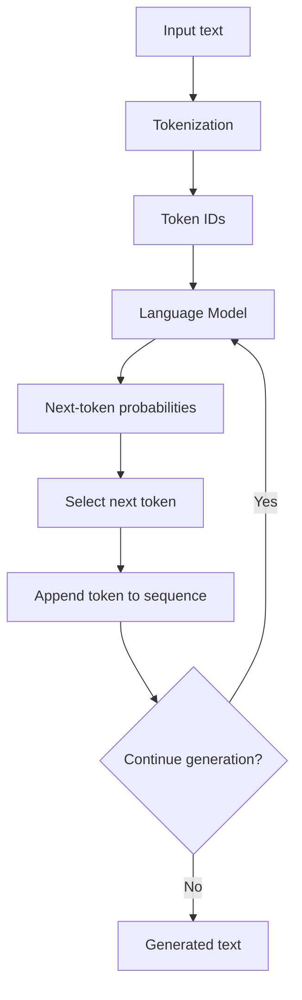
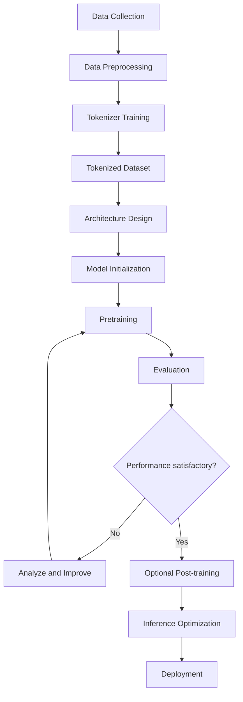
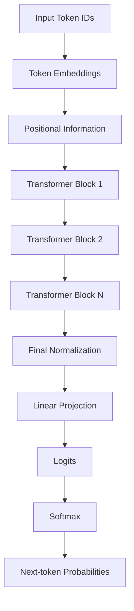
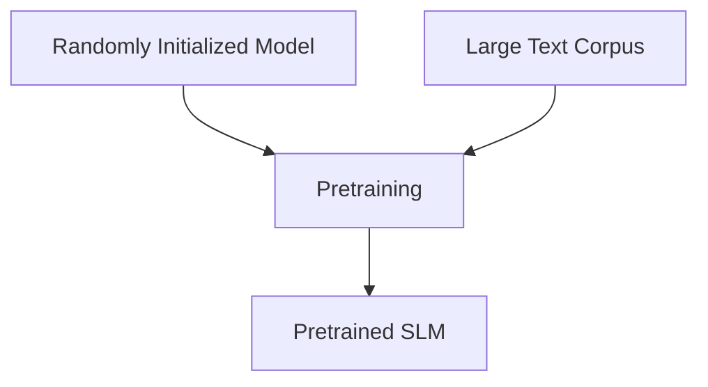
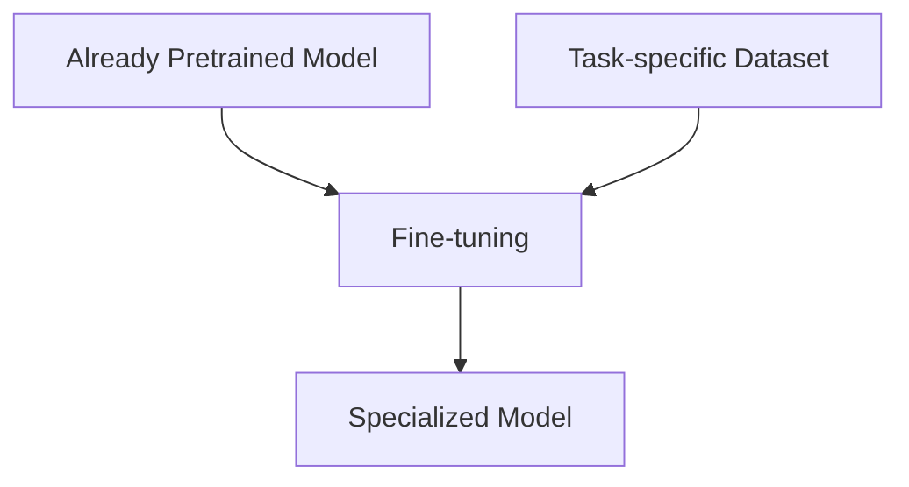
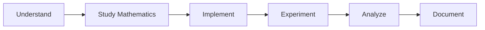

# 🧠 Small Language Models — From Scratch

### Understanding. Building. Pretraining. Optimizing.

<p align="center">
  <strong>A hands-on journey into understanding and building Small Language Models from randomly initialized weights.</strong>
</p>

<p align="center">
  
  
  
  
</p>

---

> **The goal:** Understand how modern Small Language Models work, learn how to construct their architecture, and eventually train our own language model from scratch.

This repository is a personal learning journey and an open-source knowledge base documenting the process of understanding, implementing, experimenting with, and training Small Language Models.

We will explore the mathematics behind Transformer architectures, investigate modern SLM design choices, prepare training datasets, implement model components using PyTorch, and progressively move towards GPU optimization using Triton.

This is not a collection of pretrained models or fine-tuning tutorials.

**We start with randomly initialized weights and work our way towards a pretrained language model.**

---

# 📚 Table of Contents

- [01. What is an SLM?](#-01-what-is-a-small-language-model)
- [02. Understanding Language Models](#-02-understanding-language-models)
- [03. What Makes a Model Small?](#-03-what-makes-a-model-small)
- [04. Why Do We Need SLMs?](#-04-why-do-we-need-small-language-models)
- [05. How Does an SLM Generate Text?](#-05-how-does-a-language-model-generate-text)
- [06. The SLM Development Lifecycle](#-06-the-complete-slm-development-lifecycle)
- [07. Inside an SLM](#-07-what-happens-inside-an-slm)
- [08. Pretraining vs Fine-tuning](#-08-pretraining-vs-fine-tuning)
- [09. SLMs Worth Studying](#-09-real-world-small-language-models)
- [10. Our Learning Roadmap](#-10-the-learning-roadmap)
- [11. Knowledge Check](#-11-test-your-understanding)
- [12. Project Philosophy](#-12-project-philosophy)

---

# 🧠 01. What is a Small Language Model?

Before understanding Small Language Models, we need to understand what a Language Model actually does.

Imagine giving a model the following sentence:

**"The capital of India is ______."**

What would you expect it to predict?

Probably:

**"New Delhi."**

Now consider another example:

**"Artificial Intelligence is transforming the way people ______."**

Possible predictions include:

- Work
- Learn
- Communicate
- Think

How does a model make these predictions?

It learns patterns from large collections of text and uses the preceding context to estimate what is likely to come next.

A **Language Model (LM)** is a machine-learning model that learns a probability distribution over sequences of tokens.

A **Small Language Model (SLM)** is a language model designed with a relatively compact parameter count and computational footprint compared with larger language models.

SLMs aim to provide useful language-model capabilities while reducing requirements such as:

- Computational resources
- Memory
- Inference latency
- Deployment cost
- Energy consumption

There is no universally accepted parameter threshold that officially defines an SLM.

The important idea is that model size, computational efficiency, capabilities, training data and deployment requirements must be considered together.

---

# 🔤 02. Understanding Language Models

## The fundamental idea: Next-token prediction

Modern autoregressive language models, including GPT-style models, learn to predict the next token based on the tokens that came before it.

Consider:

```text
Input:
The sun rises in the

Possible next token:
morning
```

The model estimates the probability of possible next tokens.

For example:

| Candidate | Probability |
|---|---:|
| morning | 72% |
| east | 12% |
| sky | 8% |
| evening | 5% |
| other | 3% |

*Illustrative probabilities, not actual model output.*

The model selects a token according to its decoding strategy, appends it to the input, and predicts again.

This process is called **autoregressive generation**.

## The mathematics behind language modeling

Suppose we have a sequence of tokens:

\[
X=(x_1,x_2,\ldots,x_t)
\]

The language model estimates the probability of the complete sequence:

\[
P(X)=P(x_1,x_2,\ldots,x_t)
\]

Using the probability chain rule:

\[
P(X)=\prod_{i=1}^{t}P(x_i\mid x_1,\ldots,x_{i-1})
\]

In simpler terms:

The probability of an entire sentence can be expressed as the product of the conditional probabilities of each token given the preceding tokens.

For example:

\[
P(\text{The sun rises})
\]

can be represented as:

\[
P(\text{The})\cdot
P(\text{sun}\mid\text{The})\cdot
P(\text{rises}\mid\text{The sun})
\]

This is the mathematical foundation of autoregressive language modeling.

<details>
<summary><strong>💡 Why is this important?</strong></summary>

Instead of explicitly programming grammar rules, sentence structures and vocabulary usage, we train the model to learn patterns from data.

The model adjusts its parameters to improve the probability assigned to appropriate next tokens.

Over training, it learns representations that capture linguistic patterns, contextual relationships and other statistical regularities in its training data.

</details>

---

# 📏 03. What Makes a Model Small?

One of the most important characteristics of a language model is its **parameter count**.

A parameter is a learnable numerical value inside a neural network.

Consider a simple linear transformation:

\[
y=Wx+b
\]

Here:

- \(W\) represents a weight matrix.
- \(b\) represents a bias vector.
- Both contain learnable parameters.

During training, the model updates these values to improve its predictions.

A model with 100 million parameters contains approximately 100 million learnable numerical values.

## Understanding model sizes

The following categories are illustrative learning categories, not official industry classifications.

| Category | Approximate parameters |
|---|---:|
| Tiny models | 1M–10M |
| Small models | 10M–500M |
| Compact foundation models | 500M–3B |
| Larger language models | 7B+ |

<details>
<summary><strong>🔍 Why do parameters matter?</strong></summary>

Parameter count influences:

1. Model storage requirements.
2. Memory required to load the model.
3. Computational requirements.
4. Training and inference costs.
5. Potential representational capacity.

However, a higher parameter count does not automatically produce a better model.

Model architecture, training data, training tokens, optimization and evaluation all matter.

</details>

## Model size is not the only measure of quality

Two models with different parameter counts can perform differently depending on:

- Dataset quality.
- Number of training tokens.
- Architecture.
- Training duration.
- Optimization strategy.
- Domain specialization.

A well-trained smaller model can outperform a significantly larger model on a narrow, specialized task.

---

# ⚡ 04. Why Do We Need Small Language Models?

If larger language models can perform more complex tasks, why build smaller ones?

Because not every application needs a massive general-purpose model.

Imagine building an AI system that classifies customer support tickets into five categories.

A compact, specialized model may be sufficient.

SLMs can offer several advantages:

| Factor | Potential SLM advantage |
|---|---|
| Memory | Lower memory requirements |
| Inference | Lower computational requirements |
| Latency | Potentially faster responses |
| Cost | Lower serving costs |
| Deployment | More opportunities for local deployment |
| Privacy | Can support on-device processing |
| Specialization | Can be optimized for a specific domain |

These are potential advantages rather than guarantees. Actual performance depends on architecture, hardware, implementation and workload.

## SLM vs LLM

| Dimension | SLM | LLM |
|---|---|---|
| Model size | Generally smaller | Generally larger |
| Compute requirements | Generally lower | Generally higher |
| Deployment | Local and edge-friendly options | Often server-based |
| General capabilities | Often more limited | Often broader |
| Specialization | Can be highly specialized | Can also be specialized |
| Inference cost | Often lower | Often higher |

**The objective is not to make the smallest possible model. It is to build a model that provides useful capabilities within a practical computational budget.**

---

# 🔄 05. How Does a Language Model Generate Text?

Let's follow a simple example.

Input:

```text
The sun rises in the
```

The model predicts:

```text
morning
```

The input becomes:

```text
The sun rises in the morning
```

The model predicts another token:

```text
and
```

The process continues.



The important idea is that the model does not generate an entire paragraph in one operation.

It generates tokens sequentially, repeatedly conditioning on the available context.

## What is a tokenizer?

A tokenizer converts text into a sequence of discrete token IDs.

For example:

```text
Input:
"Training a language model"

Tokens:
["Training", " a", " language", " model"]

Token IDs:
[4521, 264, 982, 1642]
```

*The IDs are illustrative.*

Mathematically:

\[
\text{Text}\rightarrow\text{Tokens}\rightarrow\text{Token IDs}
\]

We will explore tokenization algorithms such as Byte Pair Encoding (BPE) in a dedicated module.

---

# 🏗️ 06. The Complete SLM Development Lifecycle

Training an SLM involves much more than creating a Transformer and calling an optimizer.

There are several interconnected stages.



## Stage 1 — Data Collection

Collect text from suitable sources:

- Public books.
- Wikipedia.
- Educational content.
- Technical documentation.
- Publicly licensed web datasets.

The objective is to construct a suitable training corpus.

## Stage 2 — Data Preprocessing

Raw text is not immediately suitable for training.

It may contain:

- Duplicate documents.
- Spam.
- Poor formatting.
- HTML artifacts.
- Unwanted content.
- Encoding errors.

We clean, filter and organize the dataset.

## Stage 3 — Tokenization

Train or select a tokenizer that converts the prepared text into token IDs.

Important decisions include:

- Tokenization algorithm.
- Vocabulary size.
- Special tokens.
- Byte-level handling.
- Multilingual support.

## Stage 4 — Architecture Design

Choose the model architecture and configuration.

For our initial implementation, we will use a decoder-only Transformer.

We will decide:

- Number of layers.
- Hidden dimension.
- Number of attention heads.
- Context length.
- Vocabulary size.
- Normalization.
- Positional embeddings.

## Stage 5 — Model Initialization

Create the architecture and initialize its parameters.

The initial model does not contain pretrained language-model weights.

For our from-scratch experiments, parameters will be initialized using appropriate initialization strategies.

## Stage 6 — Pretraining

Train the model using next-token prediction.

The model receives token sequences, predicts the next tokens, calculates a loss and updates its parameters.

## Stage 7 — Evaluation

Measure how well the model has learned.

We will study:

- Training loss.
- Validation loss.
- Perplexity.
- Generation quality.
- Benchmark performance.

## Stage 8 — Optional Post-training

Adapt the pretrained model to instruction following or conversational tasks.

Techniques include:

- Supervised Fine-Tuning (SFT).
- Preference optimization.
- Alignment methods.

## Stage 9 — Inference and Deployment

Make the trained model usable.

Explore:

- Decoding strategies.
- KV caching.
- Quantization.
- Model serialization.
- Serving.

---

# 🧩 07. What Happens Inside an SLM?

For our initial model, we will study a decoder-only Transformer architecture.

The following diagram shows its high-level computational flow.



## Understanding the components

### 1. Token Embeddings

Token IDs are converted into dense numerical vectors.

For example, if the embedding dimension is 512, every token is represented using a vector of 512 numbers.

### 2. Positional Information

The model needs information about token positions and sequence order.

Techniques such as:

- Learned positional embeddings.
- Sinusoidal positional encodings.
- Rotary Position Embeddings (RoPE).

help incorporate positional information.

### 3. Self-Attention

Self-attention allows each token position to incorporate information from other relevant positions.

The fundamental scaled dot-product attention equation is:

\[
\operatorname{Attention}(Q,K,V)
=
\operatorname{softmax}
\left(
\frac{QK^T}{\sqrt{d_k}}
\right)V
\]

Where:

- Q = Queries.
- K = Keys.
- V = Values.
- \(d_k\) = Key dimension.

We will derive this equation and implement it ourselves.

### 4. Feed-Forward Network

Transforms the representation at each token position using learned nonlinear operations.

### 5. Residual Connections and Normalization

Help improve optimization and training stability in deep Transformer networks.

### 6. Output Projection

Produces vocabulary-sized logits representing scores for possible next tokens.

If the vocabulary contains 32,000 tokens:

\[
\text{Logits}\in\mathbb{R}^{32000}
\]

Softmax converts these scores into a probability distribution.

<details>
<summary><strong>💡 Why are we studying these components?</strong></summary>

We will not treat the Transformer as a black box.

Our objective is to understand:

- What each component does.
- Why it exists.
- Its mathematical formulation.
- How it transforms tensors.
- How it affects training.
- How it can be optimized.

Eventually, we will implement these components using PyTorch and investigate selected operations using Triton.

</details>

---

# ⚖️ 08. Pretraining vs Fine-tuning

This is one of the most important distinctions in this repository.

We are primarily interested in **pretraining from scratch**.

## A. Pretraining from scratch



The model starts without pretrained language-model weights.

It learns language patterns by training on a large text corpus.

## B. Fine-tuning an existing model



The model already has learned representations.

Fine-tuning adapts those representations to another task or domain.

| Aspect | Pretraining | Fine-tuning |
|---|---|---|
| Starting point | Random initialization | Pretrained weights |
| Dataset | Large-scale corpus | Usually task/domain-specific |
| Objective | Learn general language patterns | Adapt existing capabilities |
| Training cost | Generally higher | Generally lower |
| Main purpose | Create a pretrained model | Specialize a model |

**Our primary objective: Build a language model from randomly initialized weights, not simply fine-tune an existing one.**

---

# 🔬 09. Real-world Small Language Models

Understanding existing models will help us make better architectural decisions.

Here are some model families worth studying.

| Model family | Organization | Why study it? |
|---|---|---|
| Phi | Microsoft | Compact model design and training data |
| Gemma | Google | Efficient architecture and model scaling |
| Qwen | Alibaba | Architecture, model configurations and multilingual capabilities |
| SmolLM | Hugging Face | Small-scale language-model development |

Recommended starting points:

- [Microsoft Phi](https://huggingface.co/microsoft)
- [Google Gemma](https://ai.google.dev/gemma)
- [Alibaba Qwen](https://qwen.ai/)
- [Hugging Face SmolLM](https://huggingface.co/HuggingFaceTB)

We will use these models as architectural and research references, not as pretrained starting points for our primary from-scratch experiments.

---

# 🗺️ 10. The Learning Roadmap

The repository follows a progressive learning approach.

Each topic will eventually have its own Jupyter notebook containing theory, mathematics, visual explanations, implementation and experiments.

- [ ] **00 — Introduction to SLMs**
  - [x] What is an SLM?
  - [ ] SLM training lifecycle
  - [ ] Anatomy of an SLM

- [ ] **01 — Tokenization**
  - [ ] Tokenizer fundamentals
  - [ ] Byte Pair Encoding
  - [ ] Train your own tokenizer
  - [ ] Vocabulary experiments

- [ ] **02 — Training Data**
  - [ ] Understanding training corpora
  - [ ] Data cleaning
  - [ ] Deduplication
  - [ ] Data filtering
  - [ ] Dataset preparation

- [ ] **03 — Transformer Architecture**
  - [ ] Transformer overview
  - [ ] Embeddings
  - [ ] Positional information
  - [ ] Self-attention
  - [ ] Multi-head attention
  - [ ] Causal attention
  - [ ] Feed-forward networks
  - [ ] Normalization
  - [ ] Build a Transformer

- [ ] **04 — SLM Architecture**
  - [ ] Decoder-only models
  - [ ] GPT architecture
  - [ ] RoPE
  - [ ] RMSNorm
  - [ ] SwiGLU
  - [ ] Grouped-query attention
  - [ ] Parameter-count calculations

- [ ] **05 — Pretraining**
  - [ ] Next-token prediction
  - [ ] Training objectives
  - [ ] Loss functions
  - [ ] Optimizers and schedulers
  - [ ] Training loop
  - [ ] Checkpointing
  - [ ] Train your first SLM

- [ ] **06 — Training Optimization**
  - [ ] GPU memory
  - [ ] Mixed precision
  - [ ] Gradient accumulation
  - [ ] Gradient checkpointing
  - [ ] torch.compile
  - [ ] Profiling

- [ ] **07 — Triton**
  - [ ] Triton introduction
  - [ ] Vector operations
  - [ ] Matrix multiplication
  - [ ] Softmax kernel
  - [ ] Normalization kernel
  - [ ] Attention kernel

- [ ] **08 — Evaluation**
  - [ ] Training and validation loss
  - [ ] Perplexity
  - [ ] Text generation
  - [ ] Model evaluation
  - [ ] Error analysis

- [ ] **09 — Inference and Deployment**
  - [ ] Decoding strategies
  - [ ] KV cache
  - [ ] Quantization
  - [ ] Model export
  - [ ] Deploy your SLM

---

# 🧪 11. Test Your Understanding

Try answering these questions before looking up the answers.

<details>
<summary><strong>Question 1 — What is the primary objective of an autoregressive language model?</strong></summary>

**Answer:** Predict the next token using the preceding context.

It learns a conditional probability distribution over possible next tokens.

</details>

<details>
<summary><strong>Question 2 — What does a model with 100 million parameters mean?</strong></summary>

**Answer:** It contains approximately 100 million learnable numerical values.

These include weights and, where applicable, biases.

</details>

<details>
<summary><strong>Question 3 — What is the difference between pretraining and fine-tuning?</strong></summary>

**Answer:** Pretraining starts from randomly initialized model weights, whereas fine-tuning starts with an already pretrained model and adapts it.

</details>

<details>
<summary><strong>Question 4 — Why do we need tokenization?</strong></summary>

**Answer:** To convert text into discrete token IDs that can be processed by a neural network.

</details>

<details>
<summary><strong>Question 5 — What is the purpose of self-attention?</strong></summary>

**Answer:** It allows token representations to incorporate contextual information from other relevant positions in the sequence.

</details>

---

# 🎯 12. Project Philosophy

This repository is designed around a simple learning cycle:



Every major topic should follow this cycle.

We will prioritize:

- Understanding over blindly copying code.
- Mathematical intuition over unexplained abstractions.
- PyTorch implementations before optimized kernels.
- Small experiments before large training runs.
- Reproducibility over impressive-looking results.
- Learning the reasoning behind architectural decisions.

## What this repository is NOT

- A general machine-learning course.
- A basic NLP tutorial.
- A collection of pretrained model downloads.
- A fine-tuning-only project.
- A collection of unexplained training scripts.

It is specifically focused on understanding and building Small Language Models.

---

# 🚀 The End Goal

By the end of this journey, we should be able to:

1. Understand modern SLM architectures.
2. Train our own tokenizer.
3. Prepare a suitable language-model training corpus.
4. Implement a decoder-only Transformer.
5. Initialize a model from scratch.
6. Build a complete pretraining pipeline.
7. Train and evaluate our own SLM.
8. Optimize selected GPU operations using Triton.
9. Understand modern SLM research.
10. Export and deploy our trained model.

**The ultimate goal is not just to train a small model. It is to understand every important decision and computation involved in creating one.**

---

<p align="center">
  <strong>Understand → Build → Train → Optimize → Deploy</strong>
  <br/>
  <sub>One concept. One notebook. One experiment at a time.</sub>
</p>

<p align="center">
  ⭐ If you find this repository useful, consider starring it and following the learning journey.
</p>
